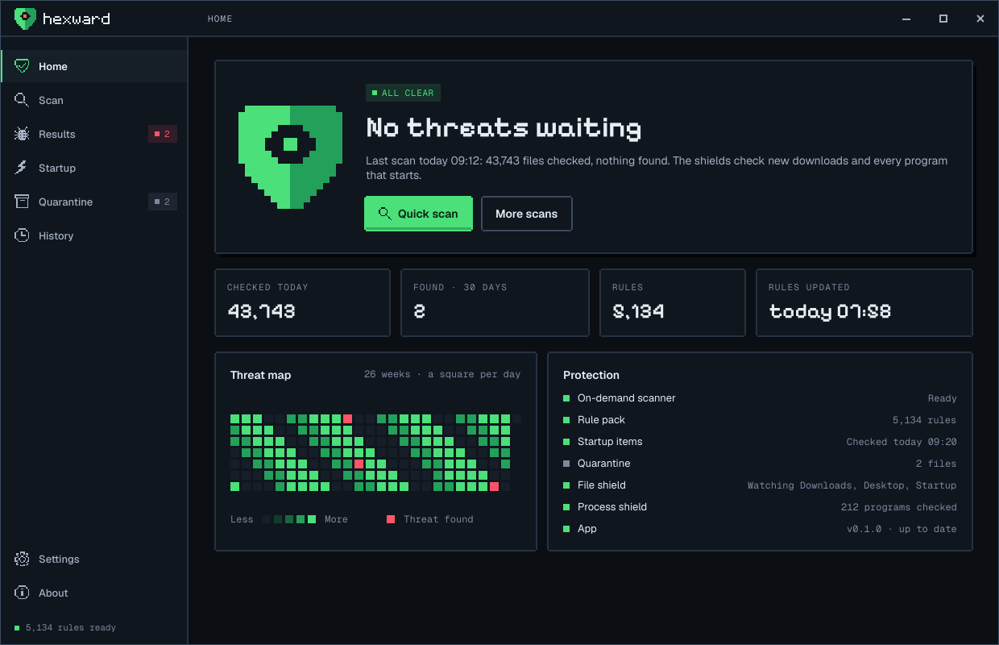
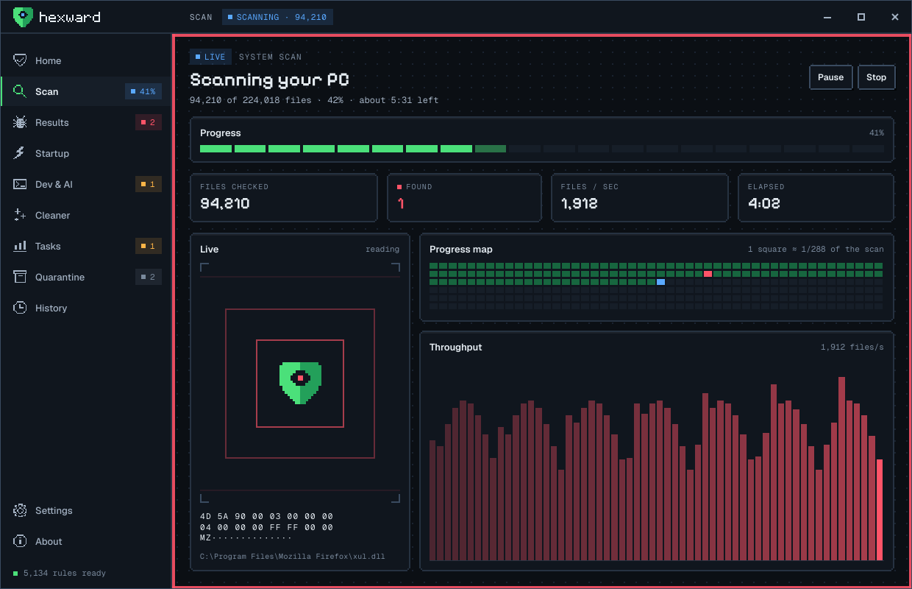
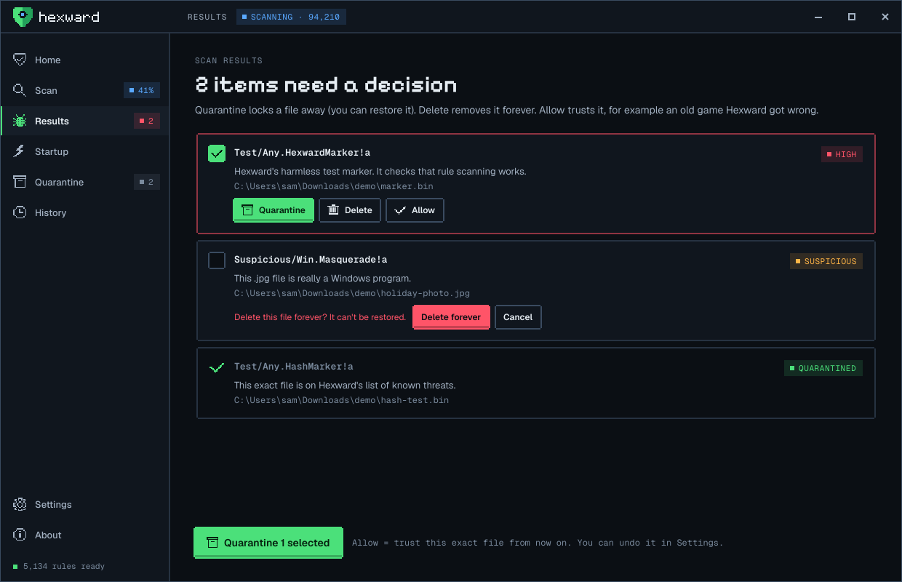
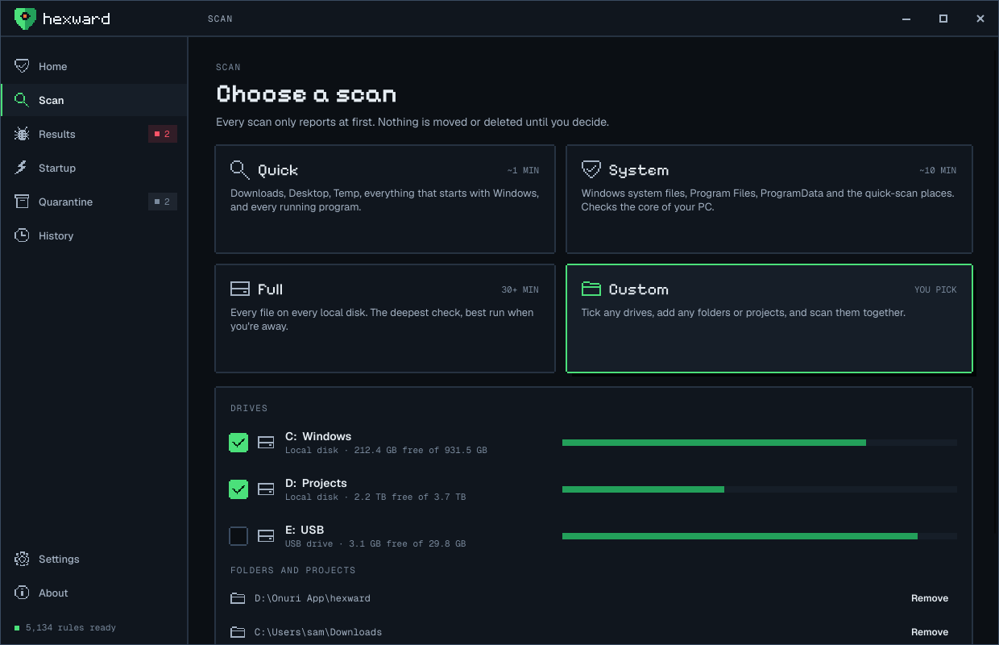
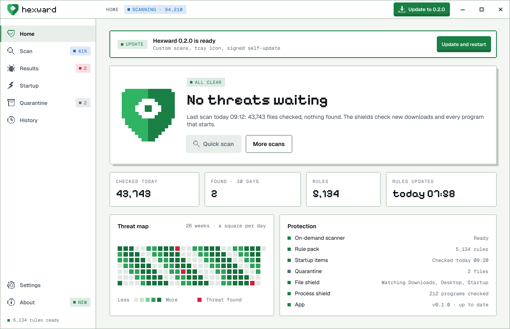
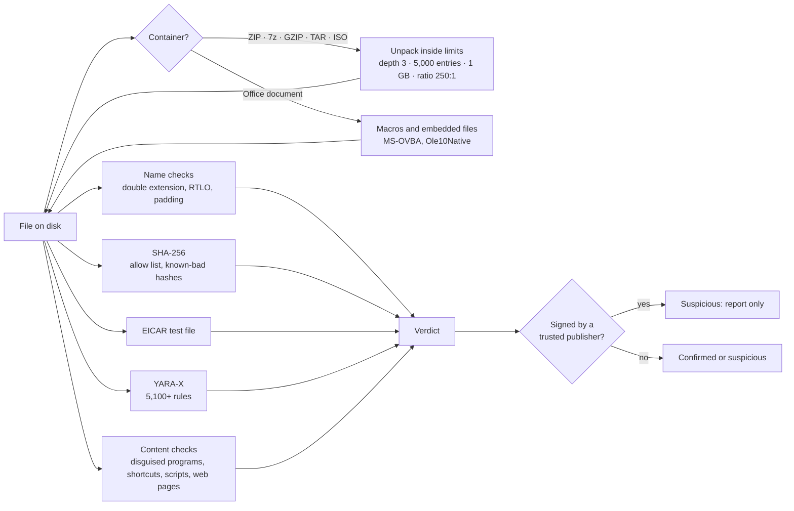
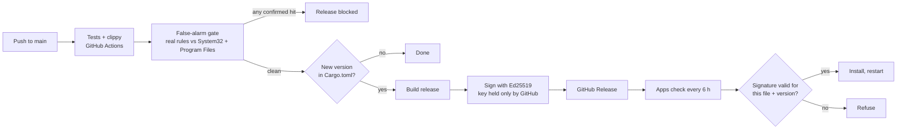

<div align="center">

<a href="https://hexward.onurilabs.com"></a>

### Every byte, warded.

**A free, open-source malware scanner and security suite for Windows, written fully in Rust.**
No account. No ads. No paid tier. Nothing leaves your PC unless you choose to send it.

[Website](https://hexward.onurilabs.com) · [Download](https://github.com/memegyanfactory-gif/hexward/releases/latest) · [Roadmap](ROADMAP.md) · [Strategy and research](docs/STRATEGY.md) · [Credits](THIRD_PARTY_NOTICES.md)




</div>

---

## What Hexward does

Hexward finds malware, explains what it found in plain words, and lets **you** decide what happens next.
It runs alongside Microsoft Defender as a second layer that looks deeper into files, makes fewer false alarms,
and covers attacks Defender wasn't built for, like weaponized shortcuts, ClickFix pages and booby-trapped Office macros.

| | |
|---|---|
| **Scans** | Quick, System, Full, or Custom (tick any drives, add any folders or projects, scan them together) |
| **Looks inside** | ZIP and everything built on it (Office, JAR, APK, MSIX), 7z, GZIP, TAR, ISO disk images, Office macros, files embedded in documents, nested 3 levels deep |
| **Detects** | 5,100+ community YARA rules, known-bad hashes, the EICAR test file, Windows file-name tricks, disguised programs, shortcut droppers, macro droppers, script droppers, HTML and SVG smuggling, ClickFix pages, zip bombs |
| **Guards in real time** | A file shield checks every new or changed file in Downloads, Desktop and the Startup folders; a process shield checks every program the moment it starts. Confirmed threats are quarantined automatically (their process stopped first); suspicious finds always wait for you |
| **Fixes** | Quarantine (encrypted, always reversible), Delete forever (asks first), or Allow (trust that exact file). Startup items can be switched off and back on |
| **Stays honest** | Signed software is never quarantined on a pattern alone. Suspicious isn't the same as confirmed, and the app shows the difference |
| **Stays fast** | A scan cache skips files a previous scan found clean with the same rules, so daily scans only read what changed |
| **Updates itself** | Signed releases from GitHub; every update's signature is checked before it installs |

<div align="center">




</div>

---

## How it works



Every file goes through five layers, cheapest first. Anything that is a container is opened and each file inside it
goes through the same layers, recursively, so a payload in `mail.zip › invoice.iso › Invoice.lnk` is found and
reported with its full path.

### Detection layers

| Layer | Finds | Verdict |
|---|---|---|
| File name | `invoice.pdf.exe`, right-to-left override characters, names padded with spaces | suspicious |
| SHA-256 | Exact known-bad files (MalwareBazaar, Hexward's list); trusted files you allowed are skipped | confirmed |
| EICAR | The standard antivirus test file (built in memory, never stored in this repo) | confirmed |
| YARA-X rules | Patterns from 5,100+ curated rules. Filename, path and extension are passed to rules that use them | confirmed or suspicious by rule score |
| Disguised programs | A `.jpg` or `.pdf` that is really a Windows program | suspicious |
| Shortcuts (.lnk) | Shortcuts that launch PowerShell, mshta, rundll32 or similar tools with download, encoded or whitespace-hidden arguments; oversized shortcuts carrying a payload | suspicious |
| Office macros | Macros that run on open and download, launch programs or inject code; each macro is also run through every YARA rule | suspicious |
| Scripts | PowerShell, batch, JS, VBS, HTA download-and-run, including **base64 `-enc` payloads, which are decoded and checked** | suspicious |
| Web pages and images | HTML and SVG smuggling, SVGs that redirect to phishing, **ClickFix** pages that copy a command and tell you to paste it | suspicious |
| Internet shortcuts (.url) | Shortcuts that open WebDAV or file shares to dodge download warnings (CVE-2024-21412 style) | suspicious |
| Containers | Zip bombs, password-protected archives hiding programs, small disk images hiding a program or shortcut | suspicious |

### Real-time shields

The shields run in user mode (no kernel driver, no admin rights, no paid certificates):

- **File shield:** watches Downloads, Desktop and both Startup folders. A new or changed file is scanned once it stops changing, so half-finished downloads are left alone.
- **Process shield:** every program that starts is scanned; each program file is checked once until it changes.
- **What happens on a hit:** a confirmed threat is quarantined automatically, and its process is stopped first. Suspicious finds are reported and left in place. Automatic quarantine can be switched off in Settings.

User mode means Hexward acts right after a file lands or a program starts, not before. Microsoft Defender keeps blocking up front, and Hexward is designed to run alongside it.

### Built not to break your PC

Antivirus products have deleted Windows system files (McAfee 2010, Webroot 2017), app shortcuts (Defender 2023)
and old games. Hexward is designed around those failures:

- **Nothing is deleted unless you click Delete.** Quarantine is encrypted (ChaCha20-Poly1305) and restores a file exactly where it was.
- **Signed software is never quarantined on a pattern alone.** If a rule hits a file with a valid Authenticode signature, it's reported as suspicious, with the reason.
- **Confirmed and suspicious are kept apart.** Only exact hash matches and high-confidence malware rules are pre-selected for quarantine. Hunting rules, hack-tool rules and machine-generated rules are always just "suspicious".
- **Allow** remembers a file by its SHA-256, so it's never flagged again, and changes to the file get it re-checked.
- **Rules with known false alarms are disabled** in [`rules/disabled.txt`](rules/disabled.txt), each with the clean file it hit.
- **Measured:** 434,191 files in `Program Files` and 22,548 in `System32` on a real PC produced zero false alarms after these fixes.

### Built for hostile files

An antivirus reads the most dangerous files on the machine, so its parsers are a target too.

- **Written in Rust**, so a crafted file can't trigger the memory bugs that C parsers suffer from.
- **Every reader has hard limits**: nesting depth, number of entries, total bytes unpacked, compression ratio. Archives are judged by their headers before anything is decompressed.
- **The ISO 9660 reader, the shortcut parser and the VBA decompressor are written from Microsoft's and ECMA's specifications**, with every offset bounds-checked. The VBA decompressor is tested against the spec's own worked examples.
- **Attack samples in the test suite are assembled from fragments at runtime**, so this repository never contains a complete attack. Other antivirus products delete source files that do.

---

## Install

**Download** the latest signed release from [Releases](https://github.com/memegyanfactory-gif/hexward/releases/latest):
`hexward-app.exe` (the desktop app) and `hexward.exe` (command line). Then:

1. Run `hexward-app.exe`.
2. Click **Download rules** on the home screen (about 1.7 MB from YARA Forge).
3. Click **Quick scan**.

**Build from source** (Rust 1.88 or newer, Windows):

```bash
git clone https://github.com/memegyanfactory-gif/hexward.git
cd hexward
cargo build --release
target\release\hexward-app.exe
```

## Command line

```bash
hexward update                          # download rule packs
hexward scan                            # quick scan
hexward scan D:\Downloads E:\           # any files, folders or drives
hexward scan --full                     # every fixed drive
hexward scan D:\x --quarantine          # move confirmed threats to quarantine
hexward startup --all                   # everything that starts with Windows
hexward quarantine list
hexward quarantine restore <id>
hexward rules --verbose                 # what's loaded, from where, and anything left out
```

Add `--json` to `scan`, `startup`, `update` and `quarantine list` for machine-readable output.
Exit codes: `0` nothing found, `1` threats found, `2` error.

## Rule packs

`hexward update` (or **Settings › Update rules**) downloads into `%LOCALAPPDATA%\Hexward\rules`:

| Pack | Source | Key | Contents |
|---|---|---|---|
| YARA Forge core (default) | [YARAHQ/yara-forge](https://github.com/YARAHQ/yara-forge) | none | ~5,100 tested community rules |
| YARA Forge extended / full | same | none | more rules, more noise |
| MalwareBazaar hashes | [bazaar.abuse.ch](https://bazaar.abuse.ch) | free [Auth-Key](https://auth.abuse.ch) in `HEXWARD_ABUSECH_KEY` | SHA-256 of fresh malware, kept and grown on every update |

A new pack replaces the old one only after it compiles, so a failed update never leaves you with fewer rules.
You can also drop your own `*.yar` rules, `*.txt`/`*.csv` hash lists and a `disabled.txt` into that folder.

## Updates and releases



- The signature covers the file name, the version and the file's SHA-256, so neither a tampered file nor an old version relabelled as new can install.
- **False-alarm gate:** before any build, the pipeline downloads the real rule pack and scans the runner's `System32` and `Program Files`. One confirmed hit on that clean software blocks the release; suspicious hits are listed in the run summary.
- The workflow pins every GitHub Action to a full commit SHA (the tj-actions lesson) and refuses to publish if the signing key is missing.
- To release: bump `version` in `Cargo.toml`, add a `## version` section to [CHANGELOG.md](CHANGELOG.md), and push.

## Privacy

- No account, no telemetry, no analytics.
- Scans, history, quarantine and settings stay in `%LOCALAPPDATA%\Hexward`.
- Network use: rule downloads (GitHub, abuse.ch) and the update check (GitHub API), and nothing else.
- Any future cloud features will be opt-in and send only hash prefixes. See [docs/STRATEGY.md](docs/STRATEGY.md).

## Project layout

```
crates/engine    scanning core: hashes, YARA-X, heuristics, containers, Office, scripts,
                 shortcuts, signatures, quarantine, startup items, allow list, history
crates/cli       the hexward command
crates/app       the desktop app (Slint): screens, tray, notifications, self-update
crates/update    rule packs (YARA Forge, MalwareBazaar) and signed app updates
crates/release   signing tool for the release pipeline
rules/           built-in test rules, test hash, disabled-rule list
assets/brand     logos (generated from the pixel grids by scripts/brand-assets.js)
docs/            strategy and research, screenshots
```

## Testing

```bash
cargo test --workspace      # 56 tests
cargo clippy --workspace --all-targets -- -D warnings
target\debug\hexward-app.exe --shots docs\screenshots   # renders every screen to PNG
```

- **What the tests cover:** detection on harmless markers and fragment-built attack samples; real Windows files
  that must stay clean (notepad.exe, every Start-menu shortcut); and hostile inputs: zip bombs, malformed archives,
  malformed shortcuts and malformed documents.
- **Also tested:** quarantine round trips, signature verification of updates, and the command line end to end.
- **Never put live malware on your main PC.** Test with the harmless markers, or in an isolated virtual machine.

## Roadmap

Hexward's goal is to be the best antivirus available: matching the leaders on protection, beating them on false
alarms and honesty, and protecting developers and AI coding agents, which nobody else does.
The full plan, with the research behind it, is in [ROADMAP.md](ROADMAP.md) and [docs/STRATEGY.md](docs/STRATEGY.md).

**Next:**
- shields for password stealers and ClickFix paste-and-run
- an AMSI provider so PowerShell, VBScript and macros are checked as they run
- a project and supply-chain scanner (npm/PyPI/Cargo install scripts, poisoned agent configs, hidden Unicode)
- more formats: RAR, CAB, MSI, NSIS/Inno installers, OneNote, PDF JavaScript

## Credits

Hexward is built on excellent open work: [YARA-X](https://github.com/VirusTotal/yara-x) by VirusTotal,
[YARA Forge](https://github.com/YARAHQ/yara-forge) and the hundreds of rule authors it collects,
[MalwareBazaar](https://bazaar.abuse.ch) by abuse.ch, [Slint](https://slint.dev), the
[Pixelify Sans](https://github.com/eifetx/Pixelify-Sans) and [Geist](https://github.com/vercel/geist-font) fonts, and
35 Rust crates from the community. [KicomAV](https://github.com/hanul93/kicomav) by Kei Choi shaped the file-format
roadmap (no code used). Full list with licences: [THIRD_PARTY_NOTICES.md](THIRD_PARTY_NOTICES.md).

## License

[GPL-3.0-or-later](LICENSE). Free forever, for everyone.

---

<div align="center">

<a href="https://onurilabs.com"></a>&nbsp;&nbsp;<a href="https://onurilabs.com"></a>

Made by **[Onuri Labs](https://onurilabs.com)** · [hexward.onurilabs.com](https://hexward.onurilabs.com)

</div>
